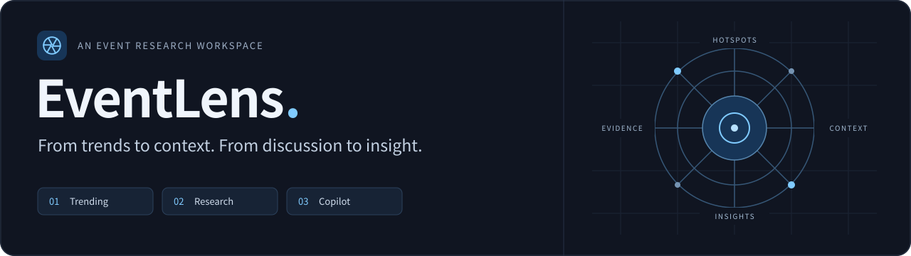
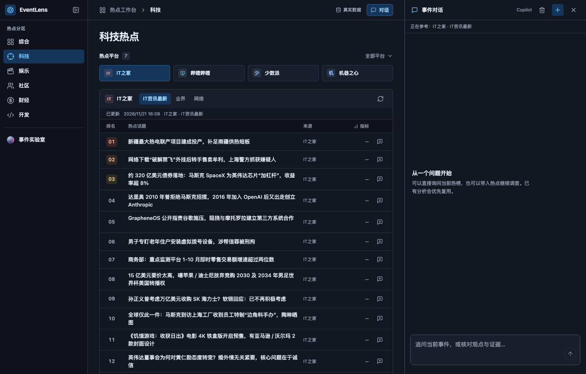
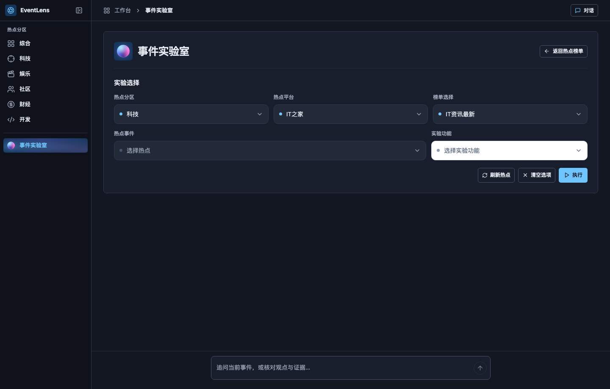
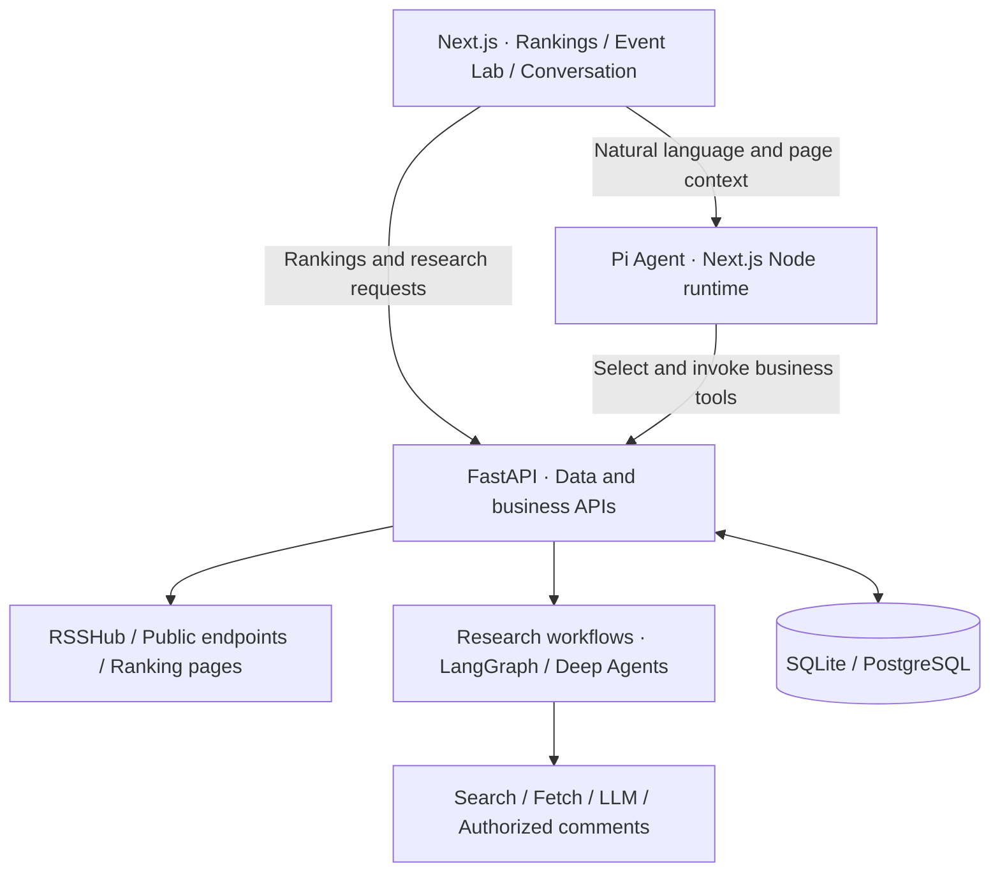

<p align="center">
  <a href="README.md">中文</a> | <a href="README.en.md"><strong>English</strong></a>
</p>

<p align="center">
  
</p>

<p align="center">
  <strong>Discover trending topics, trace events, and understand public discussions.</strong><br />
  A full-stack workspace that brings trends, evidence, and AI-assisted research together.
</p>

<p align="center">
  
  
  
  
  
</p>

<p align="center">
  <a href="#features">Features</a> ·
  <a href="#preview">Preview</a> ·
  <a href="#quick-start">Quick Start</a> ·
  <a href="#configuration">Configuration</a> ·
  <a href="#documentation">Documentation</a>
</p>

---

## Why EventLens

Trending lists show what is attracting attention, but they rarely explain the full story.

EventLens connects the next steps: **discover a topic, examine the evidence, and develop an informed understanding.** Browse platform rankings, investigate a selected event in the Event Lab, or ask follow-up questions in the sidebar and let Copilot choose the tools it needs.

> EventLens is a local research workspace under active development. Rankings use real sources. AI features require model and service configuration. Upstream failures are reported explicitly; demo data does not silently replace missing real data.

## Preview

### Trending workspace

Switch categories on the left, browse platforms and rankings in the center, and continue your investigation in the conversation sidebar. Open an item's original link directly or attach it to a conversation.



<details>
<summary><strong>View the Event Lab</strong></summary>

<br />

The lab reuses the same categories, platforms, boards, and trending data: select an event, choose a research function, run the task, and review the results.



</details>

<sub>Screenshots show the actual application. Ranking content reflects the capture time, not live data or guaranteed future availability. The application interface is currently in Chinese.</sub>

## Features

| Capability | What you can do | Implementation |
| --- | --- | --- |
| **Multi-platform rankings** | Browse General, Technology, Entertainment, Community, Finance, and Development; switch platforms and sub-boards | RSSHub, public endpoints, and ranking pages with prioritized fallback sources |
| **Event Tracing** | Search public information, investigate gaps, and build a source-linked event timeline | LangGraph + Search / Fetch + Pydantic structured output |
| **Public Opinion Intelligence** | Study topics, emotions, opinions, controversies, and evidence-supported context in real comments | Two Deep Agents, batched comment analysis, deterministic statistics, and interactive charts |
| **EventLens Copilot** | Ask about the current board, reference an event, and continue a conversation with access to existing research capabilities | Pi Agent, page context, SSE, conversation history, and tool calling |
| **Traceable results** | Inspect timeline sources, chart-linked comments, original posts, and report limitations | Source IDs and on-demand evidence browsing, with excerpts, full text, and inferences distinguished |

### Designed for browsing and research

- **Continuous browsing:** expandable platform lists, board switching, loading skeletons, refresh, and retry. Failed refreshes retain the last successful data and timestamp.
- **Shared data:** the lab reuses the existing ranking configuration, access layer, and cache rather than maintaining a separate topic list.
- **Natural conversation:** streaming responses, stop generation, retry, and source links. Conversations can be restored or cleared independently.
- **Interactive evidence:** display topics, emotions, stances, comment timestamps, and post contributions when supported by data; inspect matching comments from chart selections.
- **Explicit limits:** popularity is not proof, and a sample of leading comments is not the opinion of an entire platform. Insufficient evidence remains visible.

### Current scope

| Module | Status |
| --- | --- |
| Rankings and Event Tracing | Available through configured sources; retrieval depends on upstream availability, network conditions, and API access |
| Event Lab opinion analysis | The backend adapter map includes Weibo, Xiaohongshu, Baidu Tieba, Bilibili, and Kuaishou. Kuaishou has no ranking entry in the current catalog. An adapter's presence does not establish successful live collection |
| Copilot opinion tools | Restricted to **Weibo, Xiaohongshu, and Baidu Tieba**; authorization, login, and collection requirements still apply |
| Douyin and Zhihu | Rankings and Event Tracing remain available; public opinion analysis is not enabled |
| User accounts and distributed execution | Not implemented; the current design targets local use with one backend worker |

## Architecture



**Frontend:** Next.js App Router, React, TypeScript, Tailwind CSS, Motion, Lucide, and Recharts.<br />
**Backend:** FastAPI, Pydantic, HTTPX, LangGraph, Deep Agents, and SQLAlchemy.<br />
**Conversation:** Pi Agent Core and an OpenAI-compatible model API run in the Next.js server runtime; no separate Node microservice is required.<br />
**Storage:** SQLite by default, with optional PostgreSQL configuration. Existing data requires a separate migration.

## Quick Start

Start with the interface and rankings, then configure your own services to enable AI. **Copying the example files does not provide model keys, platform login sessions, or comment data.**

| What you want to run | Required steps |
| --- | --- |
| Interface and live rankings | Steps 1–4 below, with at least one accessible ranking source |
| Copilot sidebar | Steps 1–5, with a model supporting streaming and tool calling |
| Event Tracing | Steps 1–5, with working search, page-reading, and model APIs |
| Public Opinion Intelligence | The configuration above plus an independent MediaCrawler installation and your own platform session, or an import of authorized comments |

### 1. Prerequisites

| Dependency | Requirement | Purpose |
| --- | --- | --- |
| Node.js | **≥ 22.19.0** | Frontend and Pi Agent runtime |
| Python | **≥ 3.11** | FastAPI and research workflows |
| Docker Compose | Optional | Run RSSHub locally, or use an existing instance |
| MediaCrawler | Required for online comment collection | Install separately, following its Python, Chromium, authorization, and platform-session requirements |

The commands below use a macOS / Linux shell. On Windows, use WSL or adapt the virtual environment activation command.

Check your versions first:

```bash
node --version
python3 --version
```

`node` must be at least `22.19.0`, and `python3` must be at least `3.11`. The system Python on macOS may still be 3.9. If you have installed a newer interpreter, use its command when creating the virtual environment—for example, `python3.11 -m venv .venv`.

```bash
git clone https://github.com/JacksonJ56/EvenLens.git EventLens
cd EventLens

# Create local configuration on first use; -n preserves existing files
cp -n backend/.env.example backend/.env
cp -n frontend/.env.local.example frontend/.env.local
```

### 2. Prepare ranking sources

To run RSSHub locally, execute this from the project root:

```bash
docker compose -f backend/compose.yaml up -d rsshub
```

If you already have an RSSHub instance, set `RSSHUB_BASE_URL` in `backend/.env` instead of starting another container. Some boards also have public-endpoint or webpage fallbacks; see the [ranking configuration guide](docs/trending.md) (Chinese).

### 3. Start the backend

Open a terminal at the project root. Make sure `python3` meets the version requirement above:

```bash
cd backend
python3 -m venv .venv
source .venv/bin/activate
python -m pip install -r requirements.txt
python -m uvicorn app.main:app --host 127.0.0.1 --port 8000
```

Backend API documentation: <http://127.0.0.1:8000/docs>.

### 4. Start the frontend

Open another terminal at the project root:

```bash
cd frontend
npm ci
npm run dev
```

Open **<http://127.0.0.1:3000>**. If the port is occupied, use the `Local` address printed by Next.js.

You can now switch categories and platforms to browse rankings. Until you configure a model, configuration-required messages in chat and research features are expected.

If backend port `8000` is occupied, choose another one, such as `8100`. Also update `EVENTLENS_BACKEND_URL` in the frontend configuration to `http://127.0.0.1:8100` and restart the frontend. Changing only one side will break the connection.

### 5. Enable AI features

Browsing rankings does not require a model key. To enable research and Copilot, configure `backend/.env`:

```env
# Credentials for search and page reading
DEEPSEEK_API_KEY=your-search-api-key

# Independent OpenAI-compatible model configuration
EVENT_TRACE_LLM_API_KEY=your-model-api-key
EVENT_TRACE_LLM_BASE_URL=https://api.deepseek.com/v1
EVENT_TRACE_LLM_MODEL=your-model-id
```

Replace the placeholders with your actual configuration. Use a model ID available to your account, and do not append `/chat/completions` to the base URL. Research requires structured output; Copilot also requires tool calling and streaming. Search / Fetch access depends on the relevant API permissions, which a chat API key alone does not establish.

Restart the backend and frontend after configuration. Copilot reuses these model settings by default; use `COPILOT_LLM_*` for a separate chat model.

Suggested checks:

1. Open the backend `/docs` page to confirm FastAPI is running.
2. Open the frontend, select a board with data, and check its source and update time.
3. After configuring the model, send a simple chat message and confirm a response.
4. Try Event Tracing. For online opinion analysis, first log in and verify a supported platform session in the lab.

### 6. Subsequent starts

Dependency installation and virtual environment creation are normally needed only on first use or after dependency changes. Keep RSSHub available, then start the two services separately:

```bash
# Terminal 1: run from the EventLens project root
cd backend
source .venv/bin/activate
python -m uvicorn app.main:app --host 127.0.0.1 --port 8000
```

```bash
# Terminal 2: run from the EventLens project root
cd frontend
npm run dev
```

If your environment requires an additional trusted CA, set `NODE_EXTRA_CA_CERTS` in your own `frontend/.env.local`. The launcher loads it before starting the Node child process. Leave it unset when the default trust store works. Do not copy the author's machine-specific paths or `.env`. Press `Ctrl+C` in each terminal to stop its service.

An isolated first-install check with blank example configuration covered fresh dependency installation, both servers, automatic database creation, real rankings, and browser interaction. See the [first-run verification record](docs/first-run.md) (Chinese) for the environment and limits of that check.

## Configuration

`.env.example` is a template. **Runtime settings come from your local `.env` files or process environment.** Preserve your existing configuration instead of repeatedly overwriting it from the template.

| Setting | Location | Purpose / default |
| --- | --- | --- |
| `RSSHUB_BASE_URL` | `backend/.env` | RSSHub address; `http://127.0.0.1:1200` by default |
| `BOARD_REFRESH_SECONDS` | `backend/.env` | Default board refresh interval: `300` seconds |
| `EVENT_TRACE_LLM_*` | `backend/.env` | Research model settings, reused by Copilot by default |
| `EVENT_TRACE_MAX_ROUNDS` | `backend/.env` | At most `3` search rounds for Event Tracing by default |
| `MEDIACRAWLER_HOME` / `MEDIACRAWLER_PYTHON` | `backend/.env` | Independent MediaCrawler checkout and Python interpreter |
| `MEDIACRAWLER_AUTHORIZED` | `backend/.env` | Authorization confirmation; defaults to `false`. Platform sessions are configured separately |
| `PUBLIC_OPINION_DATABASE_URL` | `backend/.env` | Defaults to `backend/data/public_opinion.sqlite3` when unset |
| `COPILOT_TOKEN_BUDGET` | `backend/.env` or the Node process environment | Per-turn byte-based budget estimate; defaults to `60000`. **Not a billed token count or monetary limit** |
| `COPILOT_MAX_MODEL_REQUESTS` | Same as above | At most `8` model requests per user question by default |
| `EVENTLENS_BACKEND_URL` | `frontend/.env.local` | FastAPI address used by Next.js; defaults to `http://127.0.0.1:8000` |
| `NEXT_PUBLIC_TRENDING_MODE` | `frontend/.env.local` | `live` uses real sources; `mock` explicitly enables ranking demo data |

### Online collection and comment imports

Online collection requires a separate MediaCrawler installation, applicable authorization, platform login, and actual access to the data. A ready configuration does not guarantee successful collection; platform verification or access refusals are reported explicitly.

If online access is unavailable, import authorized JSON / CSV comments in the lab to continue with preparation, real LLM analysis, and report generation. See the [comment import format](frontend/public/public-opinion-import.md) and [opinion analysis guide](backend/PUBLIC_OPINION.md) for installation and session details. Both guides are currently in Chinese.

## Project Structure

```text
EventLens/
├── frontend/
│   ├── src/app/                 # Pages, theme, and Next.js server APIs
│   ├── src/components/          # Navigation, rankings, lab, chat, and charts
│   ├── src/hooks/               # Board, conversation, session, and task state
│   ├── src/lib/                 # Catalog, API clients, Pi Agent, and tools
│   ├── src/types/               # Business data types
│   ├── src/mocks/               # Explicit ranking demo data
│   └── tests/                   # Copilot core tests and browser fixtures
├── backend/
│   ├── app/event_trace/         # Event Tracing workflow
│   ├── app/public_opinion/      # Post discovery, comments, research, and reports
│   ├── app/copilot/             # Internal tool bridge, conversations, and jobs
│   ├── boards.json             # Board sources and fallbacks
│   ├── compose.yaml            # RSSHub and optional PostgreSQL
│   └── tests/                  # API, workflow, data, and evidence regression tests
├── docs/                       # README assets and technical guides
├── README.md                   # Chinese README
├── README.en.md                # English README
└── COPILOT.md                  # Agent configuration and function-by-function flow
```

## Development and Validation

```bash
# Frontend: types, core scheduling / SSE tests, and production build
cd frontend
npm run typecheck
npm run test:copilot
npm run build
```

```bash
# Backend: use the environment with the required dependencies installed
cd backend
source .venv/bin/activate
python -m unittest discover -s tests -v
```

Automated tests use substitute models and external responses; they do not consume real API credits by default. Passing tests validates code behavior, not permanent upstream availability or successful live collection on every platform. Browser fixture instructions are in the [Copilot guide](COPILOT.md) (Chinese).

## FAQ

<details>
<summary><strong>A ranking is empty or refresh fails. What should I check?</strong></summary>

Check that RSSHub and FastAPI are running, then inspect the sources in `backend/boards.json`. The backend tries fallbacks in priority order. If every source fails, it returns cached data with its original update time when available, or an error when no data exists. Websites and network policies can change; a historical verification record is not a guarantee of current availability.

</details>

<details>
<summary><strong>Copilot reports a budget limit or an HTTPS certificate error.</strong></summary>

Configure the budget in `backend/.env`. The runtime compacts historical tool text, reuses identical tool results, and reserves room for the final answer. Byte-based budget estimates and provider-reported token usage are tracked separately.

For certificate errors, configure a valid trusted CA path in `NODE_EXTRA_CA_CERTS` in `frontend/.env.local`, then restart the frontend. `npm run dev` / `npm start` load this setting before launching Next.js. See the [Copilot configuration guide](COPILOT.md) (Chinese).

</details>

<details>
<summary><strong>Do I need PostgreSQL? Where are conversations and reports stored?</strong></summary>

Local development defaults to `backend/data/public_opinion.sqlite3`, so no separate database server is required. Conversations and research data share this persistence layer. If needed, start PostgreSQL with the Compose `opinion` profile and configure the database URL. Existing SQLite data is not migrated automatically.

</details>

<details>
<summary><strong>Is this ready for public, multi-user deployment?</strong></summary>

The current implementation targets local research. Copilot restricts its entry points to local origins. There is no complete account system, unified production authentication, or distributed task queue. Public deployment requires these capabilities; the development server should not be treated as a multi-user service.

</details>

## Documentation

The English README covers setup and usage. The application interface and the detailed guides below are currently in Chinese.

| Guide | Contents |
| --- | --- |
| [Rankings and sources](docs/trending.md) | Platform / board mapping, APIs, fallbacks, and historical verification |
| [Event Tracing](docs/event-tracing.md) | Model and search setup, supplementary retrieval, timelines, and the actual call chain |
| [Public Opinion Intelligence](backend/PUBLIC_OPINION.md) | Platform capabilities, collection and imports, Deep Agents, storage, and tasks |
| [Copilot](COPILOT.md) | Pi SDK, tools, conversation context, budgets, certificates, and startup |
| [Report visualization](frontend/docs/public-opinion-visualization.md) | Chart statistics, linked comment evidence, dynamic modules, and validation |
| [Comment import format](frontend/public/public-opinion-import.md) | JSON / CSV fields, ordering, and authorization |

## Feedback and Dependencies

Report problems through [Issues](https://github.com/JacksonJ56/EvenLens/issues). Include the category, platform, board, reproduction steps, and a redacted error message. Do not submit API keys, cookies, local `.env` files, or personal research databases.

Thanks to [RSSHub](https://github.com/DIYgod/RSSHub), [HotPush](https://github.com/JackyST0/hotpush), [Pi](https://github.com/earendil-works/pi), [LangGraph](https://github.com/langchain-ai/langgraph), [Deep Agents](https://github.com/langchain-ai/deepagents), and [MediaCrawler](https://github.com/NanmiCoder/MediaCrawler) for their tools and references.

MediaCrawler is installed independently. Review its [Non-Commercial Learning License](https://github.com/NanmiCoder/MediaCrawler/blob/main/LICENSE) and applicable platform access requirements before use. This repository does not currently include a separate `LICENSE` file; third-party projects retain their own licensing terms.

---

<p align="center">
  <strong>EventLens</strong><br />
  <sub>Every trend is a starting point for a better question.</sub>
</p>
