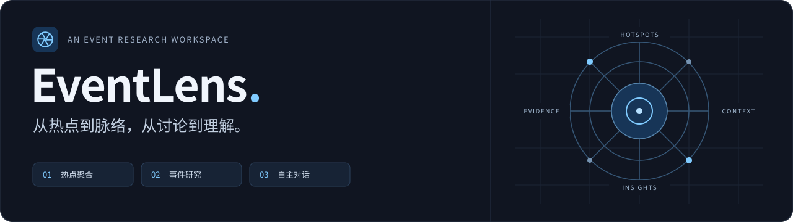
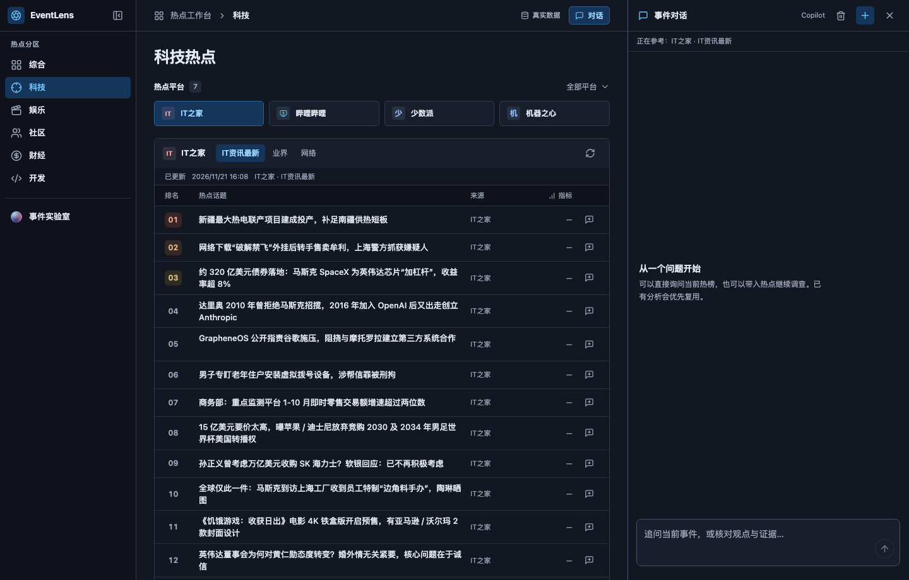
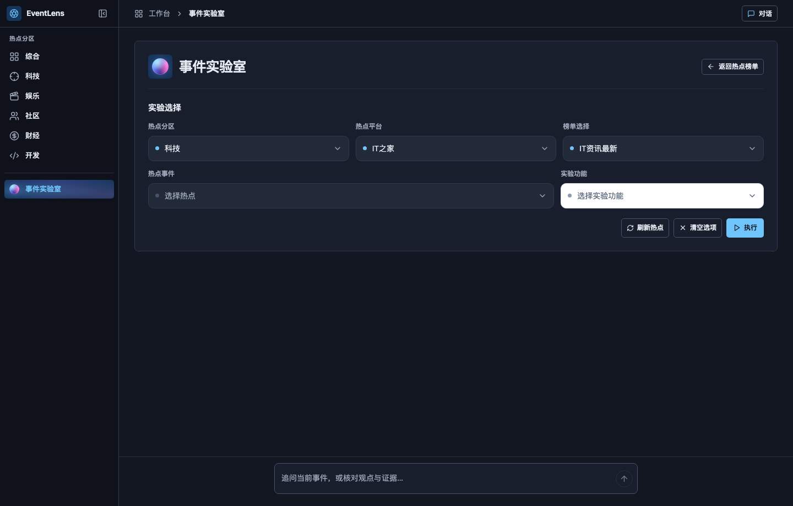
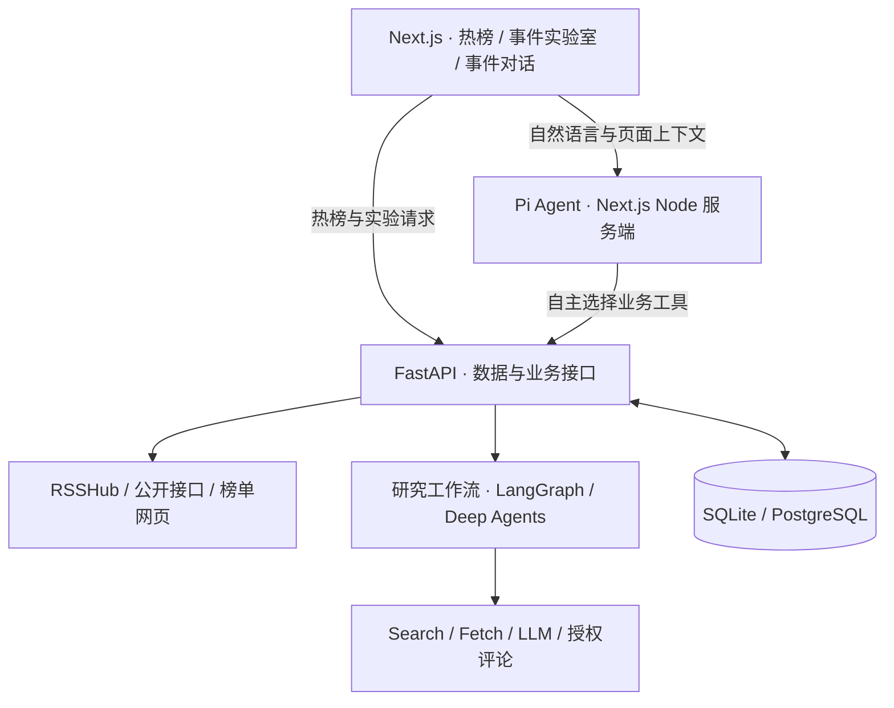

<p align="center">
  
</p>

<p align="center">
  <strong>聚合多平台热点，追溯事件发展，理解公众讨论。</strong><br />
  一个把热榜、证据与 AI 研究放在同一工作台里的全栈项目。
</p>

<p align="center">
  
  
  
  
  
</p>

<p align="center">
  <a href="#功能亮点">功能亮点</a> ·
  <a href="#界面预览">界面预览</a> ·
  <a href="#快速开始">快速开始</a> ·
  <a href="#配置说明">配置说明</a> ·
  <a href="#开发文档">开发文档</a>
</p>

---

## 为什么做 EventLens

热榜告诉我们什么正在受到关注，却不一定能解释事情的来龙去脉。

EventLens 尝试把这个过程连接起来：**先发现热点，再查看证据，最后形成有依据的理解。** 你可以浏览不同平台的榜单，进入事件实验室开展专题研究，也可以在右侧直接追问，让 Copilot 按需调用现有工具。

> 当前为持续开发中的本地研究工作台。热榜接入真实来源，AI 功能需要配置模型及相关服务；第三方源失败时会显示真实状态，不用演示数据填补。

## 界面预览

### 热点工作台

左侧切换分区，中部浏览平台与榜单，右侧承接事件对话。热点条目直接打开平台原文，也可一键带入聊天。



<details>
<summary><strong>展开查看事件实验室</strong></summary>

<br />

沿用同一套分类、平台、榜单及热点数据，完成「选择热点 → 选择功能 → 执行 → 查看结果」。



</details>

<sub>截图来自本地实际运行界面；榜单内容仅代表截图时刻，不代表实时数据或永久可用性。</sub>

## 功能亮点

| 能力 | 可以做什么 | 实现方式 |
| --- | --- | --- |
| **多平台热榜** | 在综合、科技、娱乐、社区、财经、开发六个分区浏览热点，切换平台及二级榜单 | RSSHub、公开接口与网页来源，按优先级故障切换 |
| **事件溯源** | 围绕所选热点检索公开资料，补充信息缺口，生成带来源的事件时间线 | LangGraph + Search / Fetch + Pydantic 结构化输出 |
| **公众舆情分析** | 研究实际评论中的主题、情绪、观点、争议及有证据的宏观关联 | 两个 Deep Agent、评论分批分析、程序统计与交互图表 |
| **EventLens Copilot** | 直接询问当前榜单、引用热点、连续追问，按需调用搜索和既有分析能力 | Pi Agent、页面上下文、SSE、多轮会话与工具调用 |
| **可追溯结果** | 查看时间线来源、图表对应评论、原始帖子及报告局限 | 来源 ID 关联、按需证据浏览，区分摘要、正文和推断 |

### 面向阅读与研究的交互

- **连贯浏览**：平台展开收起、分榜切换、加载骨架、刷新重试；上游失败时保留上次成功数据和更新时间。
- **共享数据**：实验室直接复用热榜配置、访问层与缓存，不另造一套热点选项。
- **自然对话**：流式输出、停止生成、错误重试、来源链接；聊天记录可恢复，也可单独清空。
- **图表联动**：有数据时展示主题、情绪、立场、评论时间与帖子贡献；点击数据点按需查看评论。
- **保持边界**：不把热度当作事实，不把前排评论样本当作全平台民意；资料不足时保留不确定性。

### 当前能力边界

| 模块 | 当前状态 |
| --- | --- |
| 热榜与事件溯源 | 按配置接入；数据获取受来源、网络和 API 权限影响 |
| 实验室公众舆情分析 | 后端适配表包含微博、小红书、百度贴吧、哔哩哔哩、快手；快手当前没有热榜入口，适配存在不等于已实采成功 |
| Copilot 舆情工具 | 仅开放 **微博、小红书、百度贴吧**；登录、授权和采集条件仍须满足 |
| 抖音、知乎 | 保留热榜和事件溯源，不开放公众舆情分析 |
| 实验功能三 | 演示占位，尚未接入真实业务 |
| 用户系统与分布式任务 | 尚未提供；当前按本机、单后端 worker 场景设计 |

## 技术架构



**前端**：Next.js App Router、React、TypeScript、Tailwind CSS、Motion、Lucide、Recharts。<br />
**后端**：FastAPI、Pydantic、HTTPX、LangGraph、Deep Agents、SQLAlchemy。<br />
**对话**：Pi Agent Core 与 OpenAI-compatible 模型接口，直接运行于 Next.js 服务端，无需额外 Node 微服务。<br />
**存储**：默认 SQLite；可通过配置接入 PostgreSQL，旧数据迁移需另外处理。

## 快速开始

### 1. 准备环境

| 依赖 | 要求 | 用途 |
| --- | --- | --- |
| Node.js | **≥ 22.19.0** | 前端与 Pi Agent 运行时 |
| Python | **≥ 3.11** | FastAPI 与研究工作流 |
| Docker Compose | 可选 | 启动本机 RSSHub；已有实例可直接配置地址 |
| MediaCrawler | 在线评论采集时需要 | 独立安装，按其要求配置 Python、Chromium、授权和平台会话 |

以下命令按 macOS / Linux shell 编写。Windows 可在 WSL 中运行，或替换虚拟环境激活方式。

```bash
git clone https://github.com/JacksonJ56/EvenLens.git EventLens
cd EventLens

# 首次创建本机配置；-n 会保留已经存在的文件
cp -n backend/.env.example backend/.env
cp -n frontend/.env.local.example frontend/.env.local
```

### 2. 准备热榜来源

使用本机 RSSHub 时，在项目根目录运行：

```bash
docker compose -f backend/compose.yaml up -d rsshub
```

已有 RSSHub 实例时，直接修改 `backend/.env` 中的 `RSSHUB_BASE_URL`，无需再启动本机容器。部分榜单具有公开接口或网页备用源，具体见 [热榜配置说明](docs/trending.md)。

### 3. 启动后端

```bash
cd backend
python3 -m venv .venv
source .venv/bin/activate
python -m pip install -r requirements.txt
python -m uvicorn app.main:app --host 127.0.0.1 --port 8000
```

后端接口文档：<http://127.0.0.1:8000/docs>。

### 4. 启动前端

另开终端，从项目根目录运行：

```bash
cd frontend
npm ci
npm run dev
```

打开 **<http://127.0.0.1:3000>**。若端口被占用，以终端输出的 `Local` 地址为准。

### 5. 启用 AI 能力

浏览热榜不需要模型密钥。启用事件研究与 Copilot 时，在 `backend/.env` 填写：

```env
# 搜索 / 网页读取的凭据
DEEPSEEK_API_KEY=your-search-api-key

# 独立的 OpenAI-compatible 模型配置
EVENT_TRACE_LLM_API_KEY=your-model-api-key
EVENT_TRACE_LLM_BASE_URL=https://api.deepseek.com/v1
EVENT_TRACE_LLM_MODEL=your-model-id
```

将占位值替换成实际配置。模型 ID 以账号当前可用列表为准，接口地址不要追加 `/chat/completions`；事件研究需要结构化输出，Copilot 还需要工具调用和流式能力。搜索 / Fetch 是否可用取决于相应 API 权限，不能仅凭拥有聊天密钥判断。

配置后重启前后端。Copilot 默认复用这套模型设置；需要独立模型时可配置 `COPILOT_LLM_*`。

## 配置说明

`.env.example` 是模板，**实际运行读取本机 `.env` 或进程环境变量**。保留已有配置即可，不必反复复制整个示例文件。

| 配置项 | 位置 | 作用 / 默认值 |
| --- | --- | --- |
| `RSSHUB_BASE_URL` | `backend/.env` | RSSHub 地址，默认 `http://127.0.0.1:1200` |
| `BOARD_REFRESH_SECONDS` | `backend/.env` | 热榜默认刷新间隔，`300` 秒 |
| `EVENT_TRACE_LLM_*` | `backend/.env` | 研究模型配置，Copilot 默认复用 |
| `EVENT_TRACE_MAX_ROUNDS` | `backend/.env` | 事件溯源最多搜索 `3` 轮 |
| `MEDIACRAWLER_HOME` / `MEDIACRAWLER_PYTHON` | `backend/.env` | 独立 MediaCrawler 仓库及 Python 路径 |
| `MEDIACRAWLER_AUTHORIZED` | `backend/.env` | 授权确认，默认 `false`；平台会话另行配置 |
| `PUBLIC_OPINION_DATABASE_URL` | `backend/.env` | 未设置时使用 `backend/data/public_opinion.sqlite3` |
| `COPILOT_TOKEN_BUDGET` | `backend/.env` 或 Node 进程环境 | 每轮字节预算估算，默认 `60000`，**不是实际 Token 数或金额** |
| `COPILOT_MAX_MODEL_REQUESTS` | 同上 | 每次提问最多 `8` 次模型请求 |
| `EVENTLENS_BACKEND_URL` | `frontend/.env.local` | Next.js 连接 FastAPI，默认 `http://127.0.0.1:8000` |
| `NEXT_PUBLIC_TRENDING_MODE` | `frontend/.env.local` | `live` 使用真实来源；`mock` 为明确标记的热榜演示模式 |

### 在线评论采集与导入

在线路径需要独立安装 MediaCrawler、适用授权、平台登录及真实访问条件。配置就绪不等于采集必然成功，平台验证或拒绝访问时会显示真实原因。

暂不满足在线条件时，可以在实验室导入已获授权的 JSON / CSV 评论，继续完成整理、真实 LLM 分析和报告生成。格式见 [评论导入说明](frontend/public/public-opinion-import.md)，安装与会话说明见 [公众舆情文档](backend/PUBLIC_OPINION.md)。

## 项目结构

```text
EventLens/
├── frontend/
│   ├── src/app/                 # 页面、主题与 Next.js 服务端 API
│   ├── src/components/          # 导航、热榜、实验室、聊天和报告图表
│   ├── src/hooks/               # 榜单、会话、登录与任务状态
│   ├── src/lib/                 # 平台配置、API Client、Pi Agent 与工具
│   ├── src/types/               # 业务类型
│   ├── src/mocks/               # 明确标记的热榜演示数据
│   └── tests/                   # Copilot 核心测试与浏览器夹具
├── backend/
│   ├── app/event_trace/         # 事件溯源工作流
│   ├── app/public_opinion/      # 帖子发现、评论、舆情研究与报告
│   ├── app/copilot/             # 内部工具桥接、会话与分析任务
│   ├── boards.json             # 榜单来源及备用路由
│   ├── compose.yaml            # RSSHub 与可选 PostgreSQL
│   └── tests/                  # 接口、工作流、数据及证据回归
├── docs/                       # 首页视觉资源及专题文档
└── COPILOT.md                  # 对话 Agent 的配置与逐函数调用链
```

## 开发与验证

```bash
# 前端：类型、核心调度 / SSE 测试、生产构建
cd frontend
npm run typecheck
npm run test:copilot
npm run build
```

```bash
# 后端：在已安装依赖的环境中运行
cd backend
source .venv/bin/activate
python -m unittest discover -s tests -v
```

自动化测试使用替代模型与外部响应，不默认消耗真实 API 额度。测试通过验证代码行为，不等于第三方来源始终可用或所有采集平台均已实测成功。浏览器夹具运行方法见 [Copilot 文档](COPILOT.md)。

## 常见问题

<details>
<summary><strong>部分热榜没有数据或刷新失败？</strong></summary>

先检查 RSSHub 与 FastAPI 是否正常运行，再核对 `backend/boards.json` 中的来源。后端会按优先级尝试备用源；全部失败时，有缓存就显示旧数据与更新时间，无缓存则显示错误。来源网站与网络策略可能变化，历史接通记录不代表当前必定可用。

</details>

<details>
<summary><strong>Copilot 提示预算不足，或者 HTTPS 证书校验失败？</strong></summary>

预算可以在 `backend/.env` 中配置。程序会精简历史工具正文、复用相同工具结果并为最终回答预留空间；字节预算和供应商实际 Token 用量分开记录。

证书错误需要让 Node 使用本机可信 CA，并在启动前设置 `NODE_EXTRA_CA_CERTS`，不是只写入后端 `.env`。具体命令及诊断方式见 [Copilot 配置说明](COPILOT.md)。

</details>

<details>
<summary><strong>需要先安装 PostgreSQL 吗？聊天和报告保存在哪里？</strong></summary>

本地默认使用 SQLite 文件 `backend/data/public_opinion.sqlite3`，不需要单独启动数据库服务。聊天与分析数据都复用这套持久化层。需要 PostgreSQL 时，可使用 Compose 的 `opinion` profile 启动并配置连接地址；SQLite 旧数据不会自动迁移。

</details>

<details>
<summary><strong>这是可以直接公网部署的多用户产品吗？</strong></summary>

当前围绕本机研究场景开发。Copilot 的入口限制本机来源，现有能力没有完整用户系统、统一生产鉴权或分布式任务队列。公共部署需要补充这些能力，不能直接把开发服务当作多用户服务。

</details>

## 开发文档

| 文档 | 内容 |
| --- | --- |
| [热榜配置与来源](docs/trending.md) | 平台 / 榜单映射、接口、备用源、历史验证记录 |
| [事件溯源](docs/event-tracing.md) | 模型与搜索配置、补充检索、时间线、实际文件调用链 |
| [公众舆情分析](backend/PUBLIC_OPINION.md) | 平台能力、评论采集与导入、Deep Agents、数据库与任务 |
| [Copilot](COPILOT.md) | Pi SDK、工具封装、多轮上下文、预算、证书与启动 |
| [报告可视化](frontend/docs/public-opinion-visualization.md) | 图表统计、评论证据联动、动态模块与验证方法 |
| [评论导入格式](frontend/public/public-opinion-import.md) | JSON / CSV 字段、排序与授权说明 |

## 反馈与依赖

欢迎通过 [Issues](https://github.com/JacksonJ56/EvenLens/issues) 反馈问题。请提供分区、平台、榜单、操作步骤和脱敏后的报错，便于复现；不要提交 API Key、Cookie、本机 `.env` 或个人研究数据库。

感谢 [RSSHub](https://github.com/DIYgod/RSSHub)、[HotPush](https://github.com/JackyST0/hotpush)、[Pi](https://github.com/earendil-works/pi)、[LangGraph](https://github.com/langchain-ai/langgraph)、[Deep Agents](https://github.com/langchain-ai/deepagents) 与 [MediaCrawler](https://github.com/NanmiCoder/MediaCrawler) 等项目提供的工具与参考。

MediaCrawler 独立安装，使用前请核对其 [非商业学习使用许可证](https://github.com/NanmiCoder/MediaCrawler/blob/main/LICENSE) 与平台访问条件。本仓库目前未附独立 `LICENSE` 文件，第三方项目仍遵循各自许可。

---

<p align="center">
  <strong>EventLens · 事件透镜</strong><br />
  <sub>让每一次热点浏览，都能继续追问。</sub>
</p>
